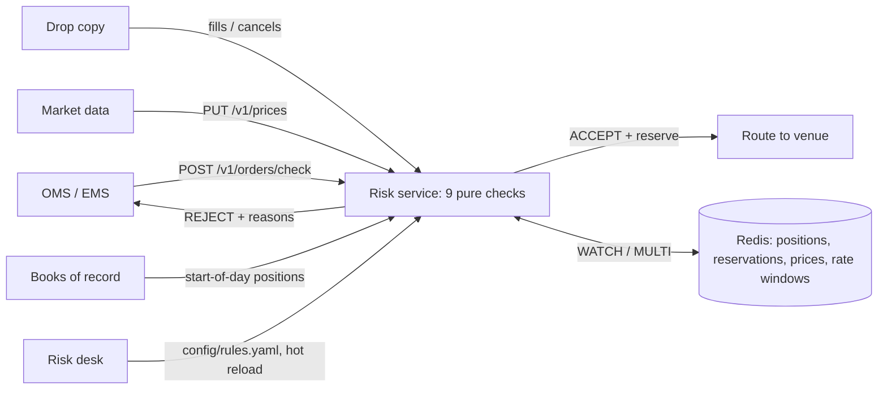
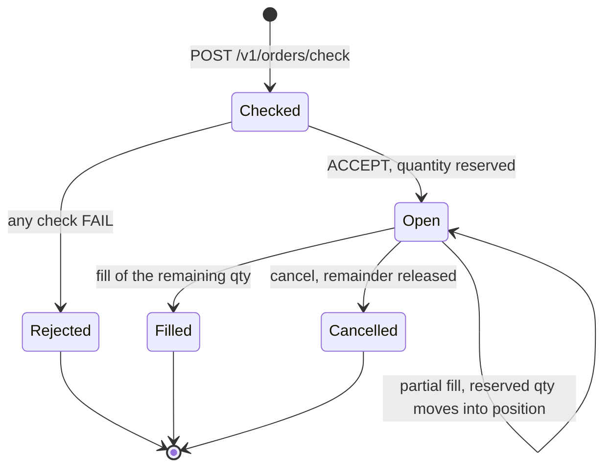
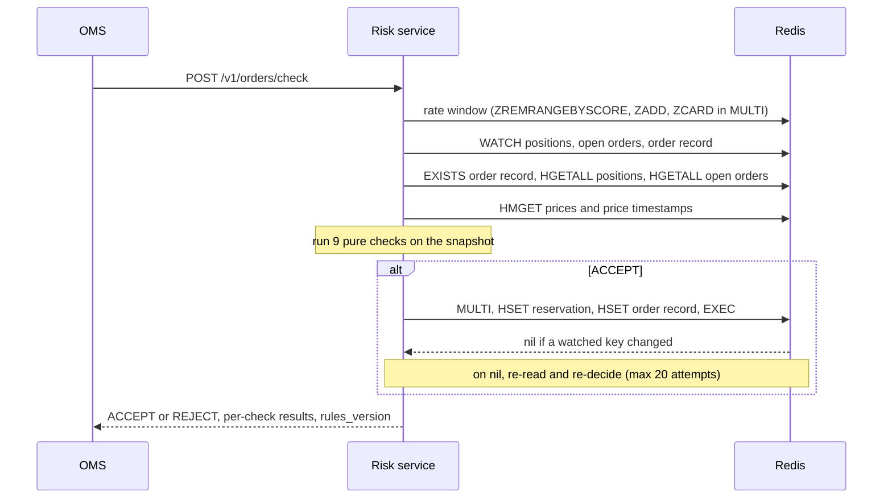

# Pre-Trade Risk Check Service

A synchronous pre-trade risk gateway. Every order is checked against configurable
limits **before** it is routed to an execution venue. The service answers `ACCEPT`
or `REJECT` with a per-check breakdown, and atomically **reserves** the accepted
quantity against the account's position and exposure limits until it is filled or
cancelled.

Limits are held in a YAML rules file ([`config/rules.yaml`](config/rules.yaml)) owned
by the risk desk and hot-reloaded without a restart. All prices, quantities and
notionals are exact `Decimal` arithmetic end to end, and every failure mode
**fails closed**.



**Contents:**
[Controls](#risk-controls) ·
[Regulatory mapping](#regulatory-mapping) ·
[Risk model](#risk-model) ·
[Decision semantics](#decision-semantics) ·
[Order lifecycle](#order-lifecycle) ·
[Consistency and concurrency](#consistency-and-concurrency) ·
[Failure modes](#failure-modes) ·
[Numerical precision](#numerical-precision) ·
[API](#api) ·
[Rules](#rules-configuration) ·
[Architecture](#architecture) ·
[Performance](#performance) ·
[Security](#security) ·
[Operations](#operations) ·
[Limitations](#known-limitations) ·
[Quick start](#quick-start) ·
[Development](#development)

---

## Risk controls

Nine controls run on every order. They never short-circuit, so a rejection reports
every breached limit at once. **All limits are inclusive**: a value exactly at the
limit passes.

| # | Check | Control type | Rejects when |
|---|---|---|---|
| 1 | `trading_enabled` | Kill switch | trading is halted firm-wide or for the account |
| 2 | `restricted_symbol` | Restricted list | the symbol is on the global or the account's restricted list |
| 3 | `order_rate` | Message throttle | the account has sent more than `max_orders_per_second` order checks in the trailing 1 s window |
| 4 | `reference_price_fresh` | Market-data integrity | the symbol's reference price is older than `max_price_age_seconds`, or has no timestamp |
| 5 | `max_order_quantity` | Fat-finger (size) | order quantity exceeds the limit |
| 6 | `max_order_notional` | Fat-finger (value) | quantity × price exceeds the limit |
| 7 | `price_collar` | Fat-finger (price) | a LIMIT price deviates from the reference price by more than `price_collar_pct` % |
| 8 | `max_position` | Position limit | the worst-case net position in the symbol after the order would exceed the limit |
| 9 | `max_gross_exposure` | Exposure limit | the account's worst-case gross exposure after the order would exceed the limit |

Position and exposure limits count **open (accepted, unfilled) orders as well as
fills**, so an account cannot exceed its limit by sending many orders that each fit
on their own.

## Regulatory mapping

The controls correspond to the pre-trade control categories in the US Market
Access Rule (SEC Rule 15c3-5) and the EU algorithmic-trading RTS (MiFID II RTS 6,
Commission Delegated Regulation (EU) 2017/589). The table shows which control
addresses which category and where the coverage is only partial.

| Requirement | Control here | Coverage |
|---|---|---|
| 15c3-5(c)(1)(ii): reject orders exceeding **size** parameters, order by order | `max_order_quantity`, `max_order_notional` | Full, per order |
| 15c3-5(c)(1)(ii): reject orders exceeding **price** parameters | `price_collar` (+ `reference_price_fresh` so the collar is never anchored to a stale price) | LIMIT orders; MARKET orders are bounded by notional at the reference price |
| 15c3-5(c)(1)(ii): limits "over a short period of time" | `order_rate` | Counts order checks per account; cancels and fills are not counted |
| 15c3-5(c)(1)(ii): reject **duplicative** orders | `client_order_id` uniqueness (HTTP 409) | Partial: catches ID reuse while an order is open, not economically identical orders under new IDs |
| 15c3-5(c)(1)(i): pre-set **credit / capital** thresholds | `max_position`, `max_gross_exposure` (including open orders) | Partial: exposure is notional at reference prices, not margin or credit usage, and is per account rather than per firm |
| 15c3-5(c)(2): restricted securities | `restricted_symbol` | Global and per account |
| RTS 6 Art. 15: price collars | `price_collar` | As above |
| RTS 6 Art. 15: maximum order value / volume | `max_order_notional` / `max_order_quantity` | As above |
| RTS 6 Art. 15: maximum messages limit | `order_rate` | Order checks only |
| RTS 6 Art. 12: kill functionality | `trading_enabled` (global and per account), hot-reloaded | Halts new orders; does not cancel resting orders at the venue |

> This mapping is engineering guidance, not legal advice. Deploying this service
> does not by itself make a firm compliant. Supervisory procedures, limit
> calibration, post-trade controls, reconciliation and record-keeping remain the
> firm's responsibility.

## Risk model

Notation for an order on account *a* in symbol *s*:

| Symbol | Meaning |
|---|---|
| Q | order quantity (> 0) |
| p | limit price (LIMIT orders) |
| r | reference price for *s* (last price published to `/v1/prices`) |
| v | valuation price: v = p for LIMIT, v = r for MARKET |
| P | filled signed net position in *s* (long > 0, short < 0) |
| B, S | open (reserved) BUY and SELL quantity in *s*, each ≥ 0 |

### Worst-case position

Open buys and open sells are tracked **separately and never netted**, because
nothing guarantees both sides fill. The position an order is judged against is the
worst case in the order's own direction:

```
q_cur = P + B      for a BUY
q_cur = P − S      for a SELL

q_new = q_cur + Q  for a BUY
q_new = q_cur − Q  for a SELL
```

### Check formulas

| Check | Passes when | Reported `value` |
|---|---|---|
| `order_rate` | n ≤ `max_orders_per_second`, where n = order checks in (t − 1000 ms, t], including this one | n |
| `reference_price_fresh` | age(r) ≤ `max_price_age_seconds` | age in seconds (ms precision) |
| `max_order_quantity` | Q ≤ L | Q |
| `max_order_notional` | Q × v ≤ L | Q × v |
| `price_collar` | \|p − r\| / r × 100 ≤ L (LIMIT only; SKIPPED for MARKET) | deviation %, shown to 4 dp |
| `max_position` | \|q_new\| ≤ L, **or** \|q_new\| < \|q_cur\| (risk-reducing) | \|q_new\| |
| `max_gross_exposure` | G + Δ ≤ L, **or** Δ ≤ 0 (risk-reducing) | G + Δ |

### Gross exposure

The account's current worst-case gross exposure, valued at reference prices:

```
G = Σ over symbols s  of  max( |P_s + B_s| , |P_s − S_s| ) × r_s
```

The order's incremental exposure, valued at the order's valuation price:

```
Δ = ( |q_new| − |q_cur| ) × v
```

Because q_cur is the directional worst case, Δ can **overstate** the increase when
the account also has open orders on the opposite side. That errs on the safe side.

### Risk-reducing orders

An order that moves the position toward flat (\|q_new\| < \|q_cur\|), or that
reduces gross exposure (Δ ≤ 0), always passes the position and exposure checks.
An account that is already over a limit, for example after the risk desk tightened
it intraday, can still trade out of the position. A flip through zero is **not**
treated as reducing unless the resulting absolute position is smaller: long 1,000
to short 5,001 is an increase.

## Decision semantics

| Outcome | Rule |
|---|---|
| `ACCEPT` | at least one check ran, and none returned `FAIL` (`SKIPPED` does not block) |
| `REJECT` | any check returned `FAIL`, or no checks ran at all (an empty engine rejects) |

- **Every check is reported** with its `status` (`PASS` / `FAIL` / `SKIPPED`),
  `reason`, `limit` and `value`, so the OMS can show the trader exactly what was
  breached and by how much.
- **Every decision carries `rules_version`,** a 12-hex-character SHA-256 prefix of
  the rules file's bytes. With the decision logs, this lets you reconstruct which
  limits were applied to any order.
- **A REJECT is a successful check and returns HTTP 200.** Non-2xx codes are reserved
  for malformed requests and infrastructure errors.

## Order lifecycle



| Event | Effect on state (atomic) |
|---|---|
| ACCEPT | B or S += Q; open-order record created with `remaining = Q` |
| Fill of f ≤ remaining | P += f (BUY) or P −= f (SELL); B or S −= f; `remaining` −= f; record deleted at 0 |
| Cancel | B or S −= remaining; record deleted |
| Overfill (f > remaining) | refused with 409; nothing changes |
| Start-of-day load | `PUT /v1/positions/{acct}/{sym}` overwrites P; reservations untouched |

Feed **exchange rejects and expiries** through `/cancel` as well; otherwise their
quantity stays reserved. A `client_order_id` can be reused once its previous order
is closed. The API has no amend operation: send cancel/replace as a cancel followed
by a new check.

## Consistency and concurrency

**Atomic check-and-reserve.** For each order the service:
1. Opens an optimistic `WATCH` on the account's position, open-order and
   order-record keys.
2. Reads a consistent snapshot of those keys.
3. Runs the checks.
4. On ACCEPT, commits the reservation in `MULTI`/`EXEC`.

If any other writer touches those keys in between, `EXEC` aborts and the order is
re-decided from a fresh snapshot, for up to 20 attempts. **Two concurrent orders
can never both pass a limit that only one of them fits under.** CI demonstrates
this against a real `redis:7`: 50 simultaneous 1,000-share orders against a 5,000
position limit accept exactly 5, and the test asserts the race was actually
contended.



- **Rules snapshot isolation.** An order reads the rule set once and uses it for
  every check and every retry. It is never evaluated against a mix of old and new
  limits.
- **Redis Cluster.** Per-account keys share an `{account}` hash tag, so the
  transaction stays in a single slot.
- **Multiple instances** share all state through Redis. Each instance hot-reloads
  the rules file independently, so for about two seconds after an edit, instances
  may apply different versions. `rules_version` on each decision records which one
  was used.

## Failure modes

The service never answers ACCEPT unless it could positively establish that the
order is within limits.

| Condition | Behaviour |
|---|---|
| Redis unreachable, timed out (default 250 ms), or erroring | `REJECT`, single check `risk_state` |
| Corrupt value in Redis (non-numeric, non-finite, malformed record) | `REJECT`, `risk_state` |
| Transaction still contended after 20 attempts | `REJECT`, `risk_state` |
| No reference price for the order's symbol | `price_collar` FAIL (LIMIT); `max_order_notional` and `max_gross_exposure` FAIL (MARKET) |
| Reference price older than `max_price_age_seconds` | `reference_price_fresh` FAIL |
| Reference price without a timestamp | `reference_price_fresh` FAIL (age unknown) |
| A held symbol has no price (exposure cannot be valued) | `max_gross_exposure` FAIL |
| A check raises an exception | that check FAILs with "internal error"; the error is logged |
| Rules file invalid at startup | the process refuses to start |
| Rules file invalid on reload | previous rules stay in force; `risk_rules_file_valid` = 0; problems listed at `/admin/rules` |
| Rules file missing on reload | previous rules stay in force; logged once |
| Duplicate open `client_order_id` | HTTP 409; nothing reserved (the attempt still counts toward `order_rate`) |

## Numerical precision

- **`Decimal` end to end.**
  - Prices, quantities, notionals and limits are Python `Decimal` from the wire to
    Redis and back.
  - The API accepts decimals as **JSON strings** (`"187.25"`) or integers. A JSON
    number with a fraction is **rejected with 422**, because the JSON parser has
    already rounded it through an IEEE-754 double: `0.1000000000000000055` arrives
    as `0.1`.
  - Responses serialise as plain decimal strings, never exponent notation.
- **YAML rules are parsed from source text** directly to `Decimal`, so `0.1` is
  exactly `0.1`. `.inf` and `.nan` are rejected.
- **Redis stores canonical decimal strings.** Arithmetic is done in Python under a
  `WATCH`, never with `HINCRBYFLOAT` or Lua (whose numbers are doubles).
- **Context.**
  - Python's default decimal context applies: 28 significant digits,
    `ROUND_HALF_EVEN`.
  - Checks only add, subtract and multiply inputs, except two divisions: the collar
    deviation, compared at full precision and reported quantised to 4 dp, and the
    price age in seconds, which divides by 1,000 and is exact.
- **Guard rail.** A test parses every module in `domain/` and `rules/` and fails on
  any use of `float`.

## API

OpenAPI UI at `/docs`. `/v1/*` requires `X-API-Key`, and `/admin/*` requires
`X-Admin-Key`. Health and metrics endpoints are open.

### Check an order

```bash
curl -X POST localhost:8000/v1/orders/check \
  -H "X-API-Key: $RISK_API_KEY" -H 'content-type: application/json' -d '{
  "client_order_id": "ord-0001", "account": "ACC-1", "symbol": "AAPL",
  "side": "BUY", "order_type": "LIMIT", "quantity": "100", "price": "187.25"
}'
```

With AAPL's reference price at 175, the 187.25 limit price sits 7% away, outside the
default 5% collar:

```json
{
  "client_order_id": "ord-0001",
  "account": "ACC-1",
  "symbol": "AAPL",
  "decision": "REJECT",
  "rules_version": "3f9c2a1b7d0e",
  "checks": [
    {"check": "trading_enabled",       "status": "PASS", "reason": null, "limit": null,       "value": null},
    {"check": "restricted_symbol",     "status": "PASS", "reason": null, "limit": null,       "value": null},
    {"check": "order_rate",            "status": "PASS", "reason": null, "limit": "50",       "value": "1"},
    {"check": "reference_price_fresh", "status": "PASS", "reason": null, "limit": "30",       "value": "0.84"},
    {"check": "max_order_quantity",    "status": "PASS", "reason": null, "limit": "10000",    "value": "100"},
    {"check": "max_order_notional",    "status": "PASS", "reason": null, "limit": "1000000",  "value": "18725.00"},
    {"check": "price_collar",          "status": "FAIL",
     "reason": "price 187.25 is 7.0000% from the reference price 175, outside the 5% collar",
     "limit": "5", "value": "7.0000"},
    {"check": "max_position",          "status": "PASS", "reason": null, "limit": "50000",    "value": "100"},
    {"check": "max_gross_exposure",    "status": "PASS", "reason": null, "limit": "10000000", "value": "18725.00"}
  ]
}
```

### Order fields

| Field | Type | Constraints |
|---|---|---|
| `client_order_id` | string | `[A-Za-z0-9][A-Za-z0-9._:-]{0,63}`; unique per account while open |
| `account` | string | `[A-Za-z0-9][A-Za-z0-9._-]{0,63}`, case-sensitive |
| `symbol` | string | up to 32 characters, normalised to upper case |
| `side` | enum | `BUY`, `SELL` |
| `order_type` | enum | `LIMIT` (requires `price`), `MARKET` (must omit `price`) |
| `quantity` | decimal string | > 0, finite |
| `price` | decimal string | > 0, finite; LIMIT only |

Unknown fields are rejected, so a misspelt field never passes silently.

### Endpoints

| Method | Path | Purpose |
|---|---|---|
| `POST` | `/v1/orders/check` | Pre-trade check; reserves on ACCEPT |
| `GET` | `/v1/orders/{account}/{client_order_id}` | Open order (quantity, remaining) |
| `POST` | `/v1/orders/{account}/{client_order_id}/fills` | `{"quantity": "40"}`: apply an execution |
| `POST` | `/v1/orders/{account}/{client_order_id}/cancel` | Release the unfilled remainder (cancel, reject, expiry) |
| `GET` | `/v1/positions/{account}` | Filled positions, open buys and sells, worst-case gross exposure |
| `PUT` | `/v1/positions/{account}/{symbol}` | `{"quantity": "-200"}`: overwrite filled position (start of day) |
| `GET` | `/v1/prices`, `/v1/prices/{symbol}` | Reference prices with `updated_at` |
| `PUT` | `/v1/prices/{symbol}` | `{"price": "187.25"}`: publish a reference price (timestamped on receipt) |
| `GET` | `/admin/rules` | Rules in force, version, load time, and a rejected file's problems if any |
| `POST` | `/admin/rules/reload` | Reload now (422 with every problem if invalid) |
| `GET` | `/admin/rules/limits?account=&symbol=` | Effective limits for an (account, symbol) pair |
| `GET` | `/health/live`, `/health/ready` | Liveness; readiness (pings Redis) |
| `GET` | `/metrics` | Prometheus exposition |

### Errors

Error bodies have the shape `{"error": "<code>", "detail": ...}`. 401 and
validation errors use FastAPI's `{"detail": ...}`.

| Status | `error` | When |
|---|---|---|
| 401 | — | missing or invalid `X-API-Key` / `X-Admin-Key` |
| 403 | — | admin API disabled (`ADMIN_API_KEY` unset) |
| 404 | `unknown_order` | fill or cancel for an order that is not open |
| 409 | `duplicate_order` | `client_order_id` already open for the account |
| 409 | `overfill` | fill exceeds the order's remaining quantity |
| 422 | — / `invalid_rules` | invalid request body / rules file rejected on reload |
| 503 | `state_unavailable` | Redis unavailable (all endpoints except `/check`, which REJECTs instead) |

## Rules configuration

The risk desk owns [`config/rules.yaml`](config/rules.yaml). The full guide for
non-developers is [docs/RULES.md](docs/RULES.md).

```yaml
schema_version: 1
trading_enabled: true            # firm-wide kill switch

defaults:                        # every limit must be set here
  max_order_quantity: 10000
  max_order_notional: 1000000
  price_collar_pct: 5
  max_position: 50000
  max_gross_exposure: 10000000
  max_orders_per_second: 50
  max_price_age_seconds: 30

restricted_symbols: [XYZ]

symbols:                         # per-symbol overrides, all accounts
  TSLA: {max_order_quantity: 2000, price_collar_pct: 3}

accounts:                        # per-account overrides
  HEDGE-01:
    max_gross_exposure: 50000000
    symbols:
      AAPL: {max_position: 200000}
  SUSPENDED-01:
    trading_enabled: false       # account kill switch
```

**Resolution order:** the most specific level wins.

```
defaults  <  symbols[s]  <  accounts[a]  <  accounts[a].symbols[s]
```

`max_gross_exposure` and `max_orders_per_second` are account-level limits and are
rejected if placed under a symbol.

**Validation.** A file is applied only if it passes every rule below; otherwise
every problem is reported, each with its path (for example
`symbols.AAPL.max_order_qty: Extra inputs are not permitted`).
- Unknown keys are errors.
- Every default is required, so nothing is unlimited by omission.
- Limits must be positive. `max_position` and `max_gross_exposure` may be 0,
  meaning reduce-only.
- `price_collar_pct` must be in (0, 100].
- Duplicate keys, including `aapl` and `AAPL`, are errors.
- Only `true`/`false` are booleans, so tickers such as `ON` or `NO` stay strings.

**Hot reload.**
- The file is polled every second (`RULES_RELOAD_INTERVAL_SECONDS`).
- A change is applied only once it is stable across two polls, so a half-written
  save is never read.
- The new rule set is validated in full and then swapped in atomically.
- A given broken file is attempted, logged and counted once, not once per poll.

## Architecture

```
src/risk_service/
├── main.py            app factory; lifespan: load rules → Redis pool → start watcher
├── container.py       long-lived objects built at startup
├── settings.py        environment configuration (pydantic-settings)
├── clock.py           injectable millisecond clock
├── api/               routers, request/response schemas, error mapping, API-key auth
├── services/
│   └── pretrade.py    one check: rules snapshot + state + engine, fail-closed, metrics
├── domain/            pure, no I/O
│   ├── models.py      Order, CheckResult, RiskDecision, Decimal wire types
│   ├── limits.py      EffectiveLimits for one (account, symbol)
│   ├── positions.py   AccountSnapshot, worst-case quantity, gross exposure
│   ├── engine.py      runs every check, fails closed on exceptions
│   └── checks/        one module per control
├── rules/             schema, hardened YAML loader, RuleSet resolution, RulesStore, RulesWatcher
├── state/             Redis: key layout, Decimal codec, prices, positions/reservations, rate limiter
└── observability/     structlog JSON logging, Prometheus metrics, request-ID middleware
```

- **Pure checks.** Every control is a function `CheckContext → CheckResult` over an
  immutable snapshot, with no I/O. That makes boundary testing exhaustive and cheap
  (at the limit, one tick over, risk-reducing, flip through zero), and it means a
  check cannot block or partially fail. Adding a control means adding one module and
  one line in `DEFAULT_CHECKS`.
- **Redis data model.** All values are canonical decimal strings.

| Key | Type | Contents |
|---|---|---|
| `risk:prices` | hash | symbol → reference price |
| `risk:prices:updated_ms` | hash | symbol → receipt time (Unix ms) |
| `risk:{acct}:positions` | hash | symbol → filled signed position |
| `risk:{acct}:open` | hash | `BUY:<sym>` / `SELL:<sym>` → reserved quantity |
| `risk:{acct}:order:<id>` | hash | symbol, side, quantity, remaining, rules_version |
| `risk:{acct}:rate` | zset | order-check timestamps in the trailing window |

## Performance

The check is on the order's critical path, so latency is dominated by Redis round
trips rather than computation.

| Path | Redis round trips |
|---|---|
| ACCEPT | 7: rate window, WATCH, EXISTS, 2 × HGETALL, price pipeline, MULTI/EXEC |
| REJECT | 7: the same reads, then UNWATCH instead of a commit |
| Each `WATCH` conflict | +6 per retry: re-WATCH, re-read, re-EXEC |

End-to-end latency is therefore about 7 × the Redis RTT plus a sub-millisecond
CPU cost. Co-locate the service with Redis. The checks themselves are pure
in-memory `Decimal` arithmetic.

`risk_check_duration_seconds` has buckets from 0.5 ms. Measure your own deployment
with the load generator:

```bash
RISK_API_KEY=... make loadtest ARGS="--url http://host:8000 --requests 20000 --concurrency 64 --accounts 200"
```

It reports throughput, p50 / p90 / p99 / p99.9 / max latency, the decision mix and
failures by check. It cancels accepted orders and refreshes prices every 5 s, so it
measures a steady state. CI runs it against the Docker Compose stack on every push.

## Security

- **Client authentication.**
  - Every `/v1/*` endpoint requires `X-API-Key`. That includes `/check`: an
    unauthenticated caller could otherwise place reservations that consume an
    account's limits and block its trading.
  - Keys are set in `API_KEYS`, comma-separated to allow rotation (`old,new`, then
    drop `old`), at least 16 characters each, and compared in constant time.
  - The process refuses to start without keys unless `API_AUTH_DISABLED=true`,
    which is meant for local development and logs a warning.
- **Separation of duties.** `/admin/*` uses a separate `ADMIN_API_KEY`. The OMS and
  the market-data feed never hold the key that reloads limits, and neither key
  opens the other's endpoints.
- **Redis.**
  - TLS via `rediss://` with options in the URL query, for example
    `?ssl_cert_reqs=required&ssl_ca_certs=/etc/ssl/ca.pem`.
  - `REDIS_PASSWORD` keeps the secret out of the URL.
  - [`deploy/redis-acl-rules`](deploy/redis-acl-rules) is a least-privilege ACL:
    only the commands the service sends, only on `risk:*` keys. CI runs the
    real-Redis tests as a user created from that file, so it cannot drift.

    ```bash
    ( set -f; redis-cli ACL SETUSER risk-service on '>STRONG-PASSWORD' $(grep -v '^#' deploy/redis-acl-rules) )
    ```
- **Your responsibility.** Terminate TLS in front of the service (it speaks plain
  HTTP), keep it on a private network, and keep `/metrics` internal.

## Operations

### Configuration

| Variable | Default | Meaning |
|---|---|---|
| `API_KEYS` | **required** | client keys for `/v1/*` |
| `API_AUTH_DISABLED` | `false` | accept `/v1/*` without a key (local development only) |
| `ADMIN_API_KEY` | unset | enables `/admin/*` |
| `REDIS_URL` | `redis://localhost:6379/0` | `rediss://` for TLS |
| `REDIS_PASSWORD` | unset | Redis password; one inside `REDIS_URL` takes precedence |
| `REDIS_SOCKET_TIMEOUT_SECONDS` | `0.25` | per-operation timeout; on timeout the order is REJECTed |
| `RULES_PATH` | `config/rules.yaml` | rules file |
| `RULES_WATCH_ENABLED` | `true` | hot reload |
| `RULES_RELOAD_INTERVAL_SECONDS` | `1.0` | poll interval |
| `LOG_LEVEL` / `LOG_JSON` | `INFO` / `true` | logging |
| `WEB_CONCURRENCY` | 1 | uvicorn worker processes (all state is in Redis) |

### Metrics and alerting

No metric is labelled by account or symbol, so series cardinality stays bounded.

| Metric | Suggested alert |
|---|---|
| `risk_state_errors_total{error}` | any increase: orders are being rejected because Redis is unusable |
| `risk_rules_file_valid` | `== 0`: a broken rules file was saved and is not in force |
| `risk_check_failures_total{check="reference_price_fresh"}` | rising during market hours: market-data feed stalled |
| `risk_check_duration_seconds` | p99 above your latency budget |
| `risk_reservation_conflicts_total` | sustained high rate: hot accounts contending |
| `risk_decisions_total{decision}` | reject ratio outside its normal band |
| `risk_rules_reloads_total{trigger,result}` | audit of limit changes |
| `risk_rules_info{version}`, `risk_rules_loaded_timestamp_seconds` | which limits are live, and since when |

### Logs and audit

- **Format.** JSON lines on stdout. Each line carries the `x-request-id`, which is
  taken from the caller when supplied, so you can correlate with OMS logs.
- **Per-decision log.** Every decision logs `client_order_id`, account, symbol,
  decision, failed checks and `rules_version`.
- **Rules history.** Reloads log the old and new versions together with what
  triggered them.

### Persistence and start of day

- **Redis persistence.** The Compose file runs Redis with AOF
  (`appendfsync everysec`), so positions and reservations survive a restart with up
  to about one second of loss.
- **Not the book of record.** The service holds a working view of positions. Load
  start-of-day positions from your books with `PUT /v1/positions/...` and reconcile
  against the drop copy.
- **After hours.** `reference_price_fresh` stops trading in any symbol whose feed
  goes quiet. Outside market hours, keep publishing closing prices or raise
  `max_price_age_seconds`.

## Known limitations

Know these before going live:

| Area | Limitation |
|---|---|
| Instruments | Notional is quantity × price. There are no contract multipliers, lot sizes or tick-size checks, so futures and options need the multiplier folded into price or quantity. |
| Currency | Single currency: all symbols and limits are assumed to be in one currency, with no FX conversion. |
| Credit | Exposure is gross notional at reference prices, not margin, buying power or credit usage, and it is per account with no firm-wide or group aggregate. |
| Exposure prices | Price staleness is enforced for the order's own symbol only. Other held symbols are valued at their last price, however old (missing prices still fail closed). |
| Order types | LIMIT and MARKET only. No amend endpoint (use cancel + new check); no stop or iceberg semantics. |
| Short selling | No locate or borrow check. |
| Throttle | `order_rate` counts order checks, not cancels or amends, and uses each instance's clock. |
| Rules rollout | Instances reload independently, so for about 2 s after an edit, instances may disagree (recorded in `rules_version`). |
| Audit | Decisions are logged, not persisted to a queryable store. |

## Quick start

**Docker** (API on :8000 with `redis:7`, using development keys):

```bash
docker compose up --build -d
```

Then open `http://localhost:8000/docs`, click **Authorize**, and enter
`dev-client-key-change-me`. Publish a price before sending orders:
`PUT /v1/prices/AAPL` with `{"price": "100"}`.

**Without Docker** you need a Redis on `localhost:6379`:

```bash
make install
cp .env.example .env
make run
```

The `.env.example` defaults disable the API-key check for local use.

## Development

```bash
make check       # ruff lint + format check, mypy --strict on src/, pytest with coverage
make fmt         # auto-fix and format
```

- **Unit tests** cover every control at its boundaries: exactly at the limit, just
  over, risk-reducing, and a flip through zero.
- **State and API tests** run against fakeredis through the real FastAPI app.
- **Real-Redis tests** cover truly concurrent orders, fills and cancels, run as the
  least-privilege ACL user. Set `REDIS_TEST_URL` to an **empty** database to run
  them; they refuse a non-empty one.

```bash
REDIS_TEST_URL=redis://localhost:6379/15 make test
```

- **CI** (GitHub Actions) has two jobs: lint, typecheck and the full test suite
  against `redis:7`; then a Docker image build, Compose smoke test (including an
  unauthenticated-request check) and the load test.

**Windows notes.**
- Keep the virtualenv outside OneDrive with
  `$env:UV_PROJECT_ENVIRONMENT = "$HOME\.venvs\pre-trade"`.
- If Smart App Control blocks the `pytest.exe` / `mypy.exe` launchers, use
  `uv run python -m pytest` / `-m mypy`.
- `make` is not installed by default; each target is a one-line `uv` command in
  the [Makefile](Makefile).
